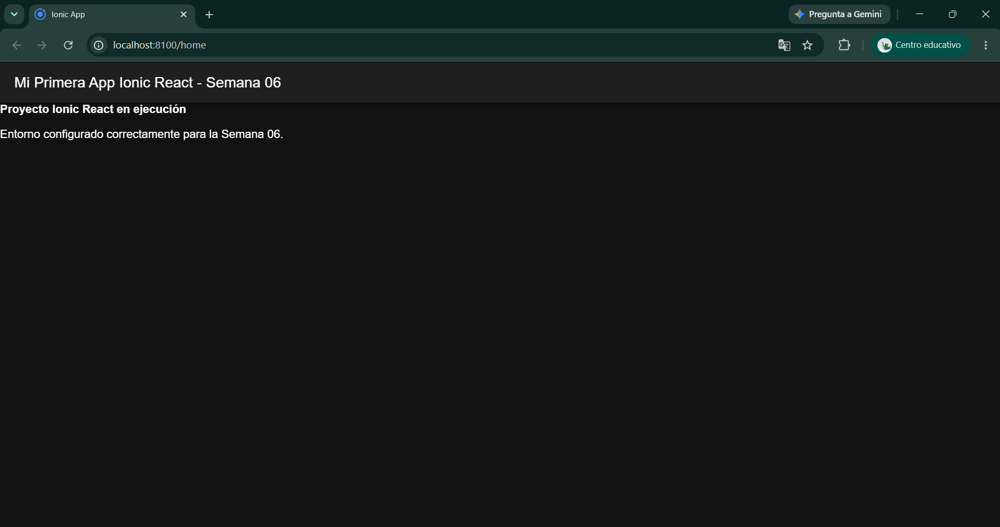

# Actividad Semana 06: Monta tu entorno y crea tu primer proyecto

## Información del Estudiante
- **Nombre Completo:** Andres Felipe Gomez Anacona
- **Usuario GitHub:** Andresfg20
- **Asignatura:** Programación Móvil - 2026-B
- **Semana:** Semana 06 (Corte 2)

---

## Descripción de la Actividad
Instalación de herramientas de desarrollo móvil (Node.js e Ionic CLI), creación de una aplicación base en **Ionic React** con la plantilla `blank`, modificación de la pantalla inicial (`Home.tsx`) y verificación del funcionamiento local.

---

## Pasos Realizados

1. **Instalación del Entorno:**
   - Verificación e instalación de Node.js LTS.
   - Instalación global del CLI de Ionic mediante npm:
     ```bash
     npm install -g @ionic/cli
     ```

2. **Creación del Proyecto Ionic React:**
   - Generación de la estructura del proyecto usando la plantilla `blank`:
     ```bash
     ionic start miApp blank --type=react --no-interactive
     ```

3. **Modificación del Código Fuente:**
   - Modificación del archivo `src/pages/Home.tsx` para cambiar el título inicial dentro del componente `<IonTitle>` por: `"Mi Primera App Ionic React - Semana 06"`.

4. **Ejecución y Prueba:**
   - Inicio del servidor de desarrollo local para verificar la renderización en el navegador:
     ```bash
     cd miApp
     ionic serve
     ```

---

## Evidencia de Ejecución

A continuación se presenta la captura de pantalla de la aplicación ejecutándose en el navegador con el título modificado:


