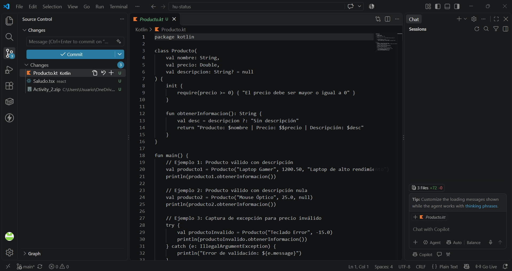

# Actividad Semana 07: Kotlin básico y un componente Ionic

## Información del Estudiante
- **Nombre Completo:** Andres Felipe Gomez Anacona
- **Usuario GitHub:** Andresfg20
- **Asignatura:** Programación Móvil - 2026-B
- **Semana:** Semana 07 (Corte 2)

---

## Descripción de la Actividad
Solución a la actividad práctica de la Semana 07. Incluye una clase en **Kotlin** (`Producto.kt`) con validación de precios y null-safety, y un componente interactivo en **Ionic React** (`Saludo.tsx`), además de la explicación conceptual requerida.

---

## Diferencias entre Kotlin y TypeScript

1. **Entorno de Ejecución y Compilación:**
   - **Kotlin:** Compila a Bytecode de Java para ejecutarse sobre la JVM o dentro del entorno nativo de Android. Es un lenguaje fuertemente tipado en tiempo de compilación y ejecución.
   - **TypeScript:** Se transpila a JavaScript estándar para ejecutarse en motores web (V8) o entornos híbridos como Capacitor.

2. **Manejo de Nulabilidad (Null-Safety):**
   - **Kotlin:** Ofrece seguridad ante nulos integrada nativamente en su sistema de tipos (`String` rechaza `null`, a menos que se defina explícitamente como `String?`).
   - **TypeScript:** Realiza la verificación de tipos y nulos únicamente durante el análisis estático en compilación; en tiempo de ejecución dicha restricción desaparece.

---

## Estructura de la Entrega

- `kotlin/Producto.kt`: Clase Kotlin con inmutabilidad (`val`), validación `precio >= 0` y operador elvis (`?:`).
- `react/Saludo.tsx`: Componente de React con TypeScript.
- `Captura.png`: Evidencia de ejecución y estructura.

---

## Evidencia de Ejecución

