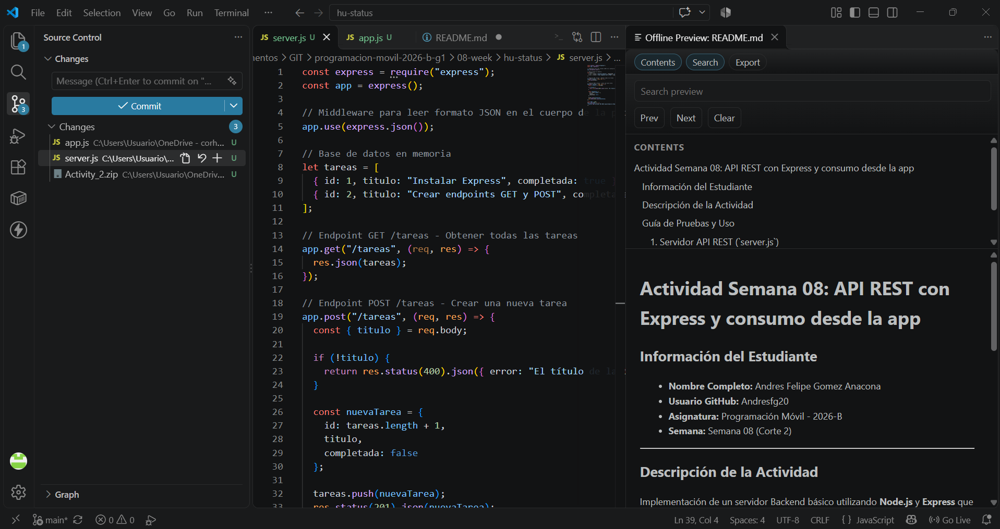

# Actividad Semana 08: API REST con Express y consumo desde la app

## Información del Estudiante
- **Nombre Completo:** Andres Felipe Gomez Anacona
- **Usuario GitHub:** Andresfg20
- **Asignatura:** Programación Móvil - 2026-B
- **Semana:** Semana 08 (Corte 2)

---

## Descripción de la Actividad
Implementación de un servidor Backend básico utilizando **Node.js** y **Express** que expone una API REST con endpoints `GET /tareas` y `POST /tareas`. Adicionalmente, se incluyen funciones desarrolladas en JavaScript con `fetch` que permiten realizar el consumo HTTP de los recursos manejando adecuadamente los errores de red y HTTP.

---

## Guía de Pruebas y Uso

### 1. Servidor API REST (`server.js`)
1. Instalar dependencias necesarias: `npm install express`
2. Iniciar el servidor: `node server.js`
3. Probar endpoints:
   - **GET `/tareas`**: Retorna el listado completo de tareas en JSON.
   - **POST `/tareas`**: Recibe un objeto `{ "titulo": "Nueva Tarea" }` en JSON y retorna el objeto creado con código `201`.

### 2. Consumo Cliente (`app.js`)
Ejecutar en la terminal `node app.js` con el servidor activo para comprobar la obtención y envío de datos con manejo de errores (`try/catch`).

---

## Evidencia de Ejecución

