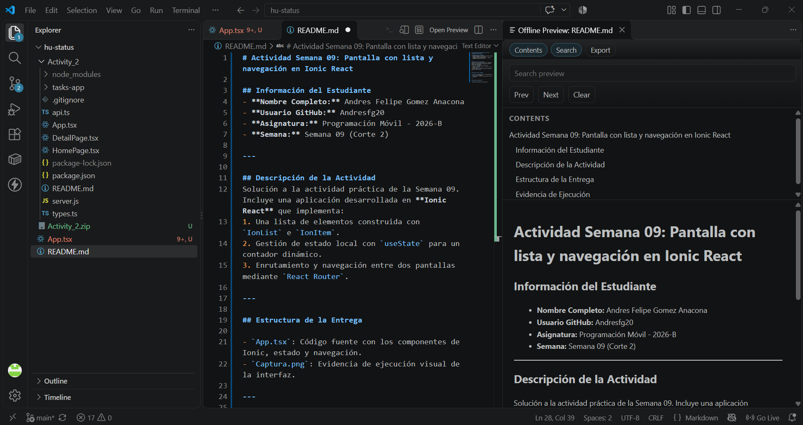

# Actividad Semana 09: Pantalla con lista y navegación en Ionic React

## Información del Estudiante
- **Nombre Completo:** Andres Felipe Gomez Anacona
- **Usuario GitHub:** Andresfg20
- **Asignatura:** Programación Móvil - 2026-B
- **Semana:** Semana 09 (Corte 2)

---

## Descripción de la Actividad
Solución a la actividad práctica de la Semana 09. Incluye una aplicación desarrollada en **Ionic React** que implementa:
1. Una lista de elementos construida con `IonList` e `IonItem`.
2. Gestión de estado local con `useState` para un contador dinámico.
3. Enrutamiento y navegación entre dos pantallas mediante `React Router`.

---

## Estructura de la Entrega

- `App.tsx`: Código fuente con los componentes de Ionic, estado y navegación.
- `Captura.png`: Evidencia de ejecución visual de la interfaz.

---

## Evidencia de Ejecución

