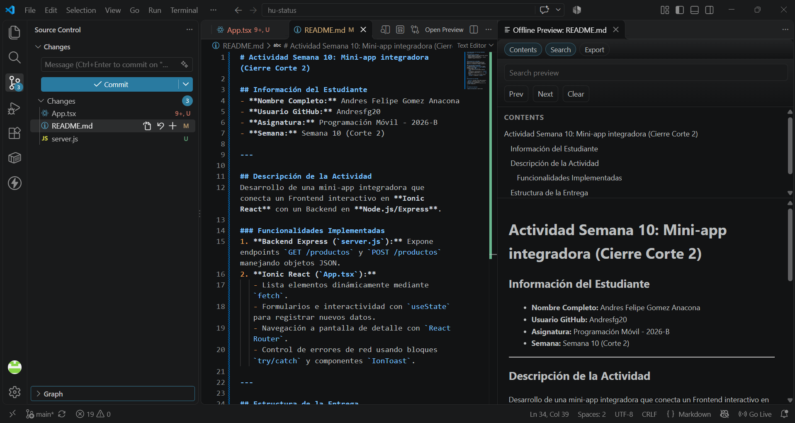

# Actividad Semana 10: Mini-app integradora (Cierre Corte 2)

## Información del Estudiante
- **Nombre Completo:** Andres Felipe Gomez Anacona
- **Usuario GitHub:** Andresfg20
- **Asignatura:** Programación Móvil - 2026-B
- **Semana:** Semana 10 (Corte 2)

---

## Descripción de la Actividad
Desarrollo de una mini-app integradora que conecta un Frontend interactivo en **Ionic React** con un Backend en **Node.js/Express**.

### Funcionalidades Implementadas
1. **Backend Express (`server.js`):** Expone endpoints `GET /productos` y `POST /productos` manejando objetos JSON.
2. **Ionic React (`App.tsx`):**
   - Lista elementos dinámicamente mediante `fetch`.
   - Formularios e interactividad con `useState` para registrar nuevos datos.
   - Navegación a pantalla de detalle con `React Router`.
   - Control de errores de red usando bloques `try/catch` y componentes `IonToast`.

---

## Estructura de la Entrega

- `server.js`: Servidor de API REST en Express.
- `App.tsx`: Frontend con lista, formulario, manejo de errores y navegación.
- `Captura.png`: Evidencia de ejecución de la solución integradora.

---

## Evidencia de Ejecución

