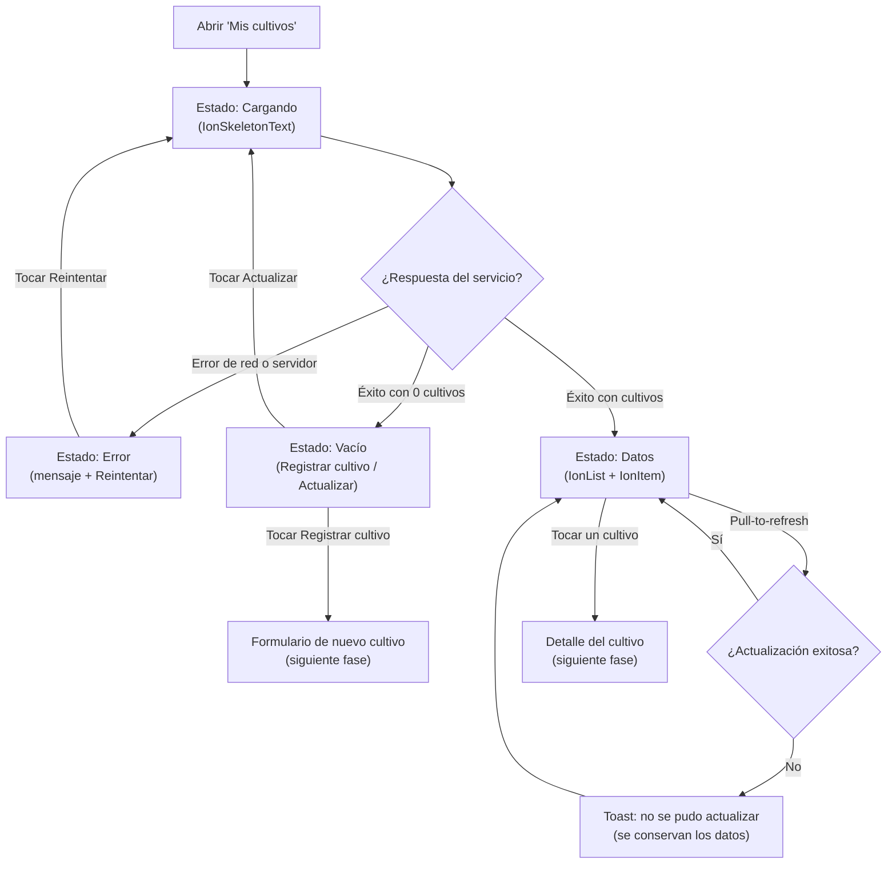

# 01 · Auditoría UX — Módulo Cultivos

**Alcance:** pantalla principal «Mis cultivos» (listado, estados de carga/vacío/error y actualización).
**Método:** evaluación heurística con las 10 heurísticas de Nielsen. Se seleccionaron las 8 con mayor impacto en un listado de cultivos usado en campo (conectividad intermitente, luz solar directa, una mano).
**Línea base:** el «problema» describe el comportamiento típico de un listado sin tratamiento de estados; la «solución» indica cómo queda resuelto en el código de este taller.

## Hallazgos

| # | Heurística de Nielsen | Problema detectado | Impacto | Solución aplicada | Evidencia |
|---|---|---|---|---|---|
| 1 | **H1. Visibilidad del estado del sistema** | Mientras se consultan los cultivos la pantalla queda en blanco; el agricultor no sabe si la app cargó o se congeló. | Alto: abandono o toques repetidos con red lenta en campo. | Skeleton de 6 filas con `IonSkeletonText`, `aria-busy="true"` y texto oculto «Cargando cultivos…» para lectores de pantalla. | `CultivosList.tsx` → `LoadingState` |
| 2 | **H2. Coincidencia entre el sistema y el mundo real** | Datos crudos tipo `lote_id: 4`, `estado: 2`, `ha: 2.5` obligan a interpretar códigos. | Medio: errores de lectura y capacitación adicional. | Lenguaje del agricultor: «Lote 4 · 2,5 ha», «Sembrado el 12 mar 2024» y estados «Sano», «Requiere atención», «Listo para cosechar». Formato `es-CO`. | `DataState`, `ESTADO_UI` |
| 3 | **H3. Control y libertad del usuario** | Sin forma de reintentar o refrescar, el usuario debe cerrar y reabrir la app. | Alto: pérdida de confianza y tareas incompletas. | Botón **Reintentar/Actualizar** en vacío y error, y `IonRefresher` (pull-to-refresh) sobre la lista. | `StatePanel`, `IonRefresher` |
| 4 | **H4. Consistencia y estándares** | Cada pantalla define sus propios colores, tamaños y mensajes de error. | Medio: interfaz impredecible, mayor costo de mantenimiento. | Tokens CSS (`--cv-*`) mapeados a variables de Ionic y un único componente de estados reutilizable para toda la entidad. | `tokens.css`, `CultivosList.tsx` |
| 5 | **H5. Prevención de errores** | Con el botón de reintento activo, varios toques lanzan peticiones simultáneas y resultados que se pisan. | Medio: datos inconsistentes y consumo de datos móviles. | Guardia `inFlight` en `useCultivos` ignora cargas concurrentes; el refresher se deshabilita durante la carga inicial. | `useCultivos.ts`, `disabled={status==='loading'}` |
| 6 | **H6. Reconocer antes que recordar** | El estado de un cultivo solo se indica con un punto de color: exige memorizar la leyenda y excluye a personas con daltonismo. | Alto: decisiones de riego/cosecha equivocadas. | Badge con **icono + texto + color** en cada ítem; nada depende solo del color. | `estado-badge` |
| 7 | **H8. Diseño estético y minimalista** | Mostrar todos los campos del cultivo en la lista satura la pantalla de 360 px. | Medio: lectura lenta bajo el sol. | Cada tarjeta muestra solo nombre, variedad/lote/área, fecha de siembra y estado; el detalle queda para la vista de cada cultivo. | `DataState` |
| 8 | **H9. Ayudar a reconocer, diagnosticar y recuperarse de errores** | Mensajes como «Error 500» o «Algo salió mal» no explican causa ni siguiente paso. | Alto: el usuario no sabe cómo continuar. | Mensaje específico («No pudimos cargar tus cultivos» + causa), `role="alert"`, y acción clara **Reintentar**. Si falla un pull-to-refresh con datos visibles, se conserva la lista y se avisa con un toast. | `StatePanel`, `useCultivos.refreshError` |

## Heurísticas no priorizadas en esta fase

- **H7 Flexibilidad y eficiencia de uso:** el pull-to-refresh aporta un atajo gestual; filtros y búsqueda quedan para fases posteriores.
- **H10 Ayuda y documentación:** se resuelve con microcopy en los estados vacíos; no se requiere documentación aparte aún.

## Diagrama de flujo de la interfaz

