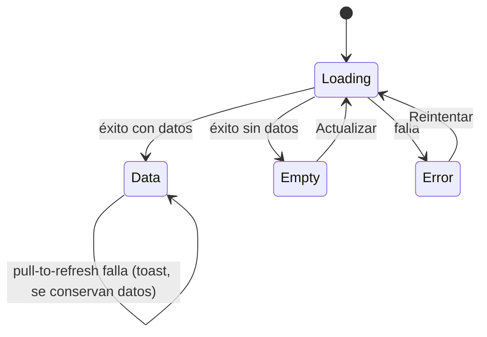

# 03 · Estados de pantalla — Módulo Cultivos

La pantalla «Mis cultivos» gestiona de forma explícita cuatro situaciones mediante `status: 'loading' | 'success' | 'error'` y la longitud de `items`.

## Máquina de estados

## Tabla de estados

| Estado | Condición | Componentes Ionic | Comunicación al usuario | Acción disponible |
|---|---|---|---|---|
| **Carga** | `status === 'loading'` | `IonList`, `IonItem`, `IonSkeletonText` (animado salvo `prefers-reduced-motion`) | Skeleton con la forma final de la lista; `aria-busy="true"`; texto SR «Cargando cultivos…» | Ninguna (refresher deshabilitado) |
| **Datos** | `status === 'success'` y `items.length > 0` | `IonList`, `IonItem`, `IonLabel`, `IonBadge`, `IonIcon` | Nombre, variedad, lote, área, fecha y estado con icono + texto | Tocar un ítem (`onSelect`), pull-to-refresh |
| **Vacío** | `status === 'success'` y `items.length === 0` | `IonIcon`, `IonButton` | «Aún no tienes cultivos» + instrucción; `role="status"` | **Registrar cultivo** (si `onCreate`), **Actualizar** |
| **Error** | `status === 'error'` | `IonIcon`, `IonButton` | «No pudimos cargar tus cultivos» + causa; `role="alert"` | **Reintentar** |

## Pull-to-refresh

- `IonRefresher slot="fixed"` con `IonRefresherContent` («Desliza para actualizar» / «Actualizando…»).
- `onIonRefresh` ejecuta `onRefresh()` y **siempre** llama a `event.detail.complete()` (también si falla) para no dejar el spinner colgado.
- Un refresco fallido **con datos visibles** no reemplaza la lista por la pantalla de error: `useCultivos` expone `refreshError` y la página lo muestra en un `IonToast`.
- La guardia `inFlight` evita lanzar una segunda petición mientras otra está en curso.

## Microcopy

| Situación | Texto |
|---|---|
| Carga (SR) | Cargando cultivos… |
| Vacío | **Aún no tienes cultivos** · Registra tu primer cultivo para seguir su estado y la fecha de cosecha. |
| Error | **No pudimos cargar tus cultivos** · {causa} / Revisa tu conexión e inténtalo de nuevo. |
| Acciones | Registrar cultivo · Actualizar · Reintentar |
| Estados del cultivo | Sano · Requiere atención · Listo para cosechar |

Reglas: oraciones en minúscula, verbos en infinitivo en los botones, sin disculpas ni mensajes vagos; el error siempre dice qué pasó y qué hacer.

## Cobertura de pruebas

| Comportamiento | Prueba en `States.test.tsx` |
|---|---|
| Skeletons visibles y vistas excluyentes | «muestra skeletons y oculta datos, vacío y error» |
| Refresher deshabilitado al cargar | «desactiva el pull-to-refresh mientras carga» |
| Render de lista y estados en texto | «renderiza un ítem por cultivo…» |
| Selección de ítem | «llama a onSelect con el cultivo tocado» |
| Vacío + acciones | «muestra el mensaje vacío…», «ofrece "Registrar cultivo"…» |
| Error + reintento | «muestra el mensaje de error con role="alert"…» |
| Conmutación completa | «pasa de carga → datos → error → carga…» |
| Pull-to-refresh | «ejecuta onRefresh y completa…», «completa… incluso si onRefresh falla» |
