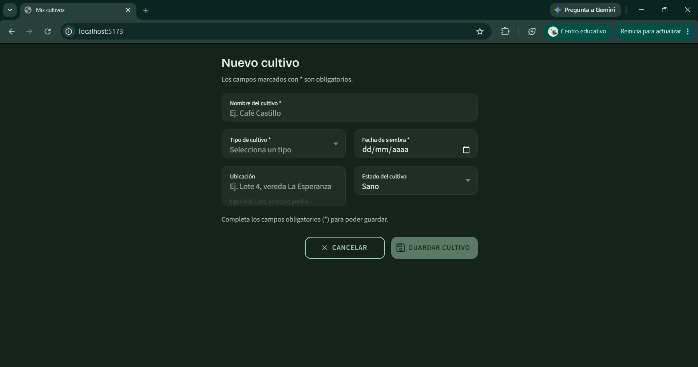
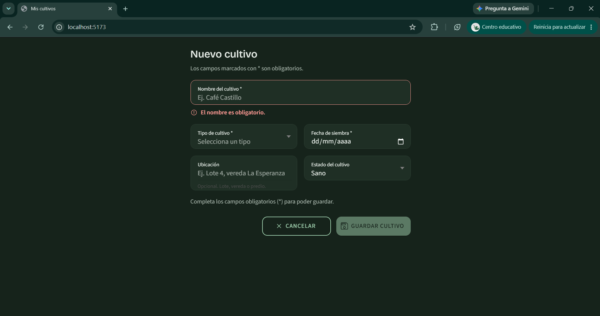

# 06 · Formulario de Cultivo (CP6)

**Estudiante:** Andrés Felipe Gómez Anacona · **Código:** 9024125527

Formulario de creación y edición de cultivos, implementado en `app/src/components/CultivoForm.tsx` con estilos en `CultivoForm.css` y pruebas en `__tests__/Form.test.tsx`.

## 1. Estructura y campos

El componente se usa en dos modos mediante la prop `mode` (`'create'` por defecto, o `'edit'`).

| Campo | Componente Ionic | Tipo | Obligatorio | Valor inicial |
|---|---|---|---|---|
| `nombre` | `IonInput` (`text`) | `string` | Sí | `''` |
| `tipo` | `IonSelect` + `IonSelectOption` | `'hortaliza' \| 'frutal' \| 'cereal' \| 'legumbre'` | Sí | sin selección |
| `fechaSiembra` | `IonInput` (`date`, `max` = hoy) | `string` ISO `YYYY-MM-DD` | Sí | `''` |
| `ubicacion` | `IonInput` (`text`) | `string` | No | `''` |
| `estado` | `IonSelect` | `'sano' \| 'atencion' \| 'cosecha'` | No | `'sano'` |

Props del componente:

| Prop | Tipo | Descripción |
|---|---|---|
| `mode` | `'create' \| 'edit'` | Define títulos, texto del botón y comportamiento tras guardar |
| `initialValues` | `Partial<CultivoFormValues>` | Valores de partida; en edición se precargan |
| `onSubmit` | `(values) => void \| Promise<void>` | Recibe los datos ya validados y normalizados |
| `onCancel` | `() => void` | Se ejecuta al cancelar (tras confirmar si hay cambios) |

`onSubmit` recibe un `CultivoFormSubmitValues`, donde `tipo` ya está garantizado como `CultivoTipo` (nunca `''`) y `nombre` y `ubicacion` llegan sin espacios en los extremos. Los valores de `initialValues` se leen solo al montar; para editar otro cultivo, el padre debe remontar el formulario con una `key` distinta.

El formulario trabaja con su propio tipo (`CultivoFormValues`) y no modifica la interfaz `Cultivo` de `types/cultivo.ts`, que sigue describiendo los datos de la lista (`variedad`, `lote`, `hectareas`). La conversión entre ambos modelos se resuelve al conectar el formulario con el servicio.

## 2. Reglas de validación

| Campo | Regla | Mensaje |
|---|---|---|
| `nombre` | No vacío tras recortar espacios | El nombre es obligatorio. |
| `nombre` | Mínimo 3 caracteres útiles | El nombre debe tener al menos 3 caracteres. |
| `tipo` | Debe ser una de las cuatro opciones | Selecciona el tipo de cultivo. |
| `fechaSiembra` | No vacía | La fecha de siembra es obligatoria. |
| `fechaSiembra` | Fecha real del calendario y desde 1900 | Ingresa una fecha válida. |
| `fechaSiembra` | No posterior a hoy (fecha local) | La fecha de siembra no puede ser futura. |

### Justificación en el dominio agrícola

- **Nombre (mínimo 3 caracteres).** Un agricultor maneja varias parcelas y cultivos a la vez. Etiquetas de uno o dos caracteres («A», «Ma») no permiten distinguir registros en listas, alertas ni reportes. Se recortan los espacios para que «   » no cuente como nombre.
- **Tipo obligatorio.** El tipo condiciona el ciclo productivo, los plazos de cosecha y el manejo (riego, fertilización). Sin tipo, el sistema no puede calcular fechas esperadas ni agrupar cultivos.
- **Fecha de siembra no futura.** La fecha de siembra es un hecho ya ocurrido y es la base de los cálculos de días desde la siembra y de la fecha estimada de cosecha. Una fecha futura describiría una planificación, no un cultivo sembrado, y falsearía esos cálculos. El atributo `max` del campo lo previene en el selector del dispositivo y la validación lo garantiza si el valor llega por otro medio.
- **Fecha desde 1900 y calendario real.** Evita valores imposibles como el 30 de febrero o años sin sentido para un registro agrícola.
- **Ubicación y estado sin validación.** La ubicación es opcional porque no todo cultivo está asociado a un lote o predio registrado. El estado siempre tiene un valor por defecto (`sano`).

### Cuándo se muestran los errores

| Momento | Comportamiento |
|---|---|
| Antes de interactuar | Sin errores visibles |
| Al salir de un campo (`blur`) | Se muestra el error de ese campo |
| Mientras se escribe | El mensaje se actualiza al instante y desaparece al corregirse |
| Al enviar con Enter con datos inválidos | Se muestran los errores de todos los campos y no se llama a `onSubmit` |

## 3. Estados y retroalimentación

| Estado | Qué ocurre |
|---|---|
| Inválido | El botón **Guardar** queda deshabilitado y aparece el texto «Completa los campos obligatorios (*) para poder guardar.» |
| Válido | El botón se habilita |
| Guardando | El botón muestra `IonSpinner` y «Guardando…», y se bloquean los campos y el botón Cancelar; los envíos repetidos se ignoran |
| Éxito | `IonToast` verde «Cultivo guardado correctamente.»; en creación el formulario se limpia, en edición los valores guardados pasan a ser la nueva base |
| Error al guardar | Mensaje con `role="alert"`: «No pudimos guardar el cultivo. Inténtalo de nuevo.»; los datos se conservan y se puede reintentar |
| Cancelar sin cambios | Ejecuta `onCancel` de inmediato |
| Cancelar con cambios | `IonAlert` «¿Descartar cambios?» con **Seguir editando** y **Descartar cambios** |

## 4. Accesibilidad

### Etiquetas y estructura

- Cada campo tiene `label` visible con `labelPlacement="stacked"`; los obligatorios llevan `*` y `aria-required="true"`.
- El formulario es un `<form>` con nombre accesible (`aria-labelledby` apuntando al título `<h2>`) y `aria-busy` mientras guarda.
- Una leyenda indica que los campos con `*` son obligatorios.

### ARIA y lectores de pantalla

| Elemento | Atributo | Motivo |
|---|---|---|
| Campos obligatorios | `aria-required="true"` | Indica obligatoriedad |
| Campo con error visible | `aria-invalid="true"` y `aria-describedby` | Marca el campo inválido y lo asocia a su mensaje |
| Mensaje de error | `role="alert"` | Se anuncia al aparecer |
| Región de guardado | `role="status"` (texto solo para lectores) | Anuncia «Guardando cultivo…» |
| Iconos y spinner | `aria-hidden="true"` | El significado ya está en el texto |
| Formulario | `novalidate` | La validación propia sustituye la del navegador |

Los componentes de Ionic renderizan el control dentro de su propio árbol, por lo que la asociación por `aria-describedby` puede no ser interpretada por todos los lectores de pantalla. Por eso el mensaje de error es además una región `role="alert"`, que se anuncia sin depender de esa asociación. Esta combinación debe confirmarse con TalkBack y VoiceOver.

### Contraste (WCAG AA, texto normal ≥ 4,5:1)

| Elemento | Colores | Ratio |
|---|---|---|
| Mensaje de error (claro) | `--cv-color-error` `#A12727` sobre `#F3F5F1` | 6,75:1 |
| Mensaje de error (oscuro) | `#FF9A94` sobre `#16231B` | 7,98:1 |
| Texto auxiliar (claro) | `--cv-ink-muted` `#4B5A50` sobre `#F3F5F1` | 6,65:1 |
| Texto auxiliar (oscuro) | `#A9B7AD` sobre `#16231B` | 7,80:1 |
| Toast de éxito (claro) | `#FFFFFF` sobre `--cv-primary` `#2C5E3B` | 7,58:1 |
| Toast de éxito (oscuro) | `#16231B` sobre `#9FD0AE` | 9,38:1 |

El error no depende solo del color: se acompaña de icono, texto y un borde reforzado en el campo.

### Interacción

- Botones y campos con altura mínima de 44 px (`--cv-touch-min`); los campos usan 56 px.
- Foco visible con anillo de 3 px (`--cv-focus`) en campos y botones.
- Responsive: una columna a 360 px; a 768 px, `Tipo`/`Fecha` y `Ubicación`/`Estado` se distribuyen en dos columnas y los botones pasan a una fila.

## 5. Tokens

`CultivoForm.css` usa los tokens de `app/src/theme/tokens.css`. Se añadieron dos alias semánticos:

```css
--cv-color-error: var(--cv-danger);
--cv-color-success: var(--cv-primary);
```

Al referenciar tokens existentes, el modo oscuro se aplica sin definiciones adicionales.

## 6. Pruebas (`Form.test.tsx`)

El archivo contiene 33 pruebas con Vitest y React Testing Library:

| Grupo | Qué verifica |
|---|---|
| Renderizado | Todos los campos, opciones de tipo, atributo `max` de la fecha y modo edición |
| Mensajes de error | Campos vacíos, nombre corto en tiempo real, solo espacios, fecha futura, fecha de hoy y envío con Enter inválido |
| Botón de envío | Deshabilitado con errores, habilitado al ser válido y de nuevo deshabilitado si el dato se invalida |
| Envío | Callback con datos normalizados, toast de éxito, limpieza tras crear, estado de carga, envío único, fallo del guardado y desmontaje |
| Cancelar | Sin cambios, con confirmación, «Seguir editando», «Descartar cambios» y base nueva tras guardar en edición |
| Funciones puras | `validateCultivoForm` y `parseCultivoForm`: fechas imposibles, año bisiesto, límite de «hoy» y recorte de espacios |

Las pruebas fallan si la consola registra `console.error` o `console.warn`.

En jsdom, el wrapper de Ionic 9 no aplica `value` ni `label` ni conecta `onIonInput`, `onIonChange` o `onIonBlur`. Por eso la prueba sustituye únicamente `IonInput`, `IonSelect`, `IonSelectOption`, `IonAlert` e `IonToast` por equivalentes nativos con el mismo contrato de props; `IonItem`, `IonButton`, `IonIcon` e `IonSpinner` son los reales. Las pruebas validan la lógica del formulario; el comportamiento visual de los componentes de Ionic se comprueba en el navegador (sección 7).

```bash
cd 11-week/workshop/app
npm test
```

## 7. Capturas de pantalla

Guardar las capturas en `docs/img/` con estos nombres:

| Archivo | Estado a capturar |
|---|---|
| `docs/img/06-form-valid.png` | Formulario completo y válido, con el botón **Guardar cultivo** habilitado |
| `docs/img/06-form-error.png` | Formulario con errores visibles bajo los campos y el botón deshabilitado |

Pasos: ejecutar `npm run dev`, abrir el formulario en un viewport de 360 px y capturar cada estado. Para el estado de error, entrar y salir de los tres campos obligatorios sin completarlos. Para el válido, escribir «Café Castillo», elegir «Frutal» y una fecha pasada.





## 8. Alcance

- El formulario no está montado en ninguna ruta de la app; se integra desde una página que le pase `onSubmit` y `onCancel`.
- El guardado lo ejecuta la función `onSubmit` recibida. El componente no incluye una simulación propia.
- Pendiente de comprobar en navegador y dispositivo: aspecto visual a 360 y 768 px, anuncios de lectores de pantalla y el selector de fecha nativo.
